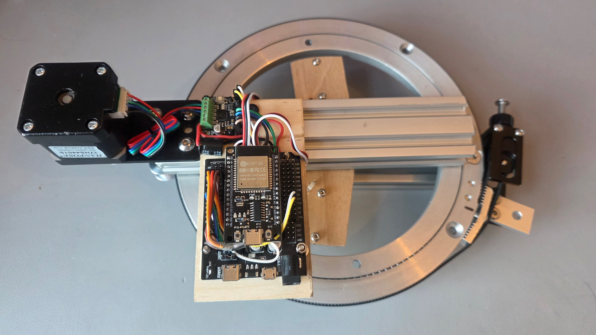
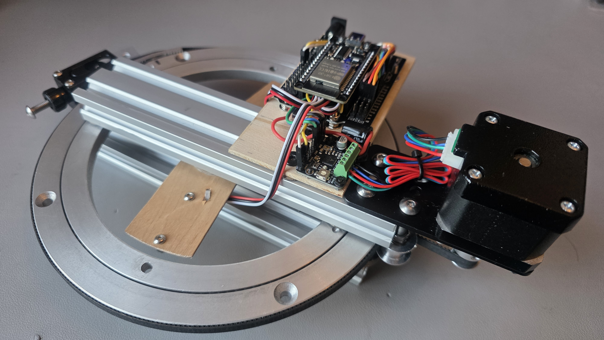
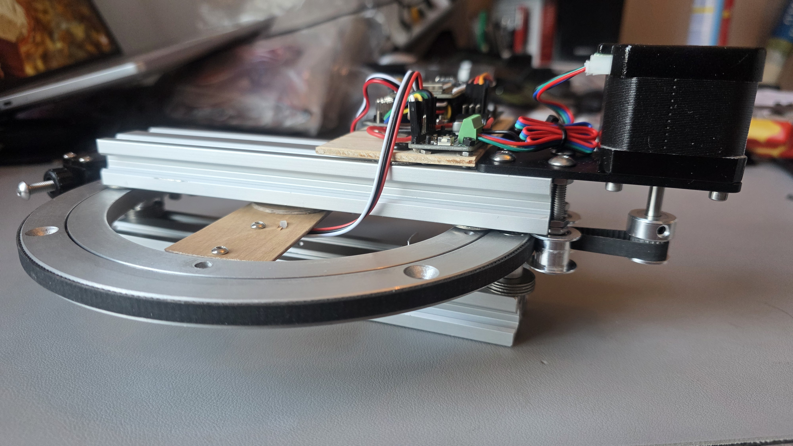
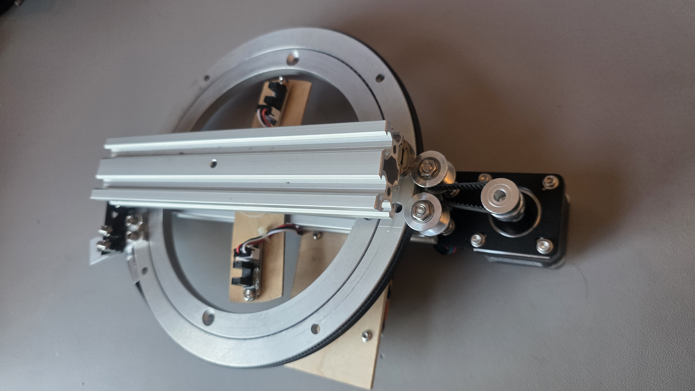
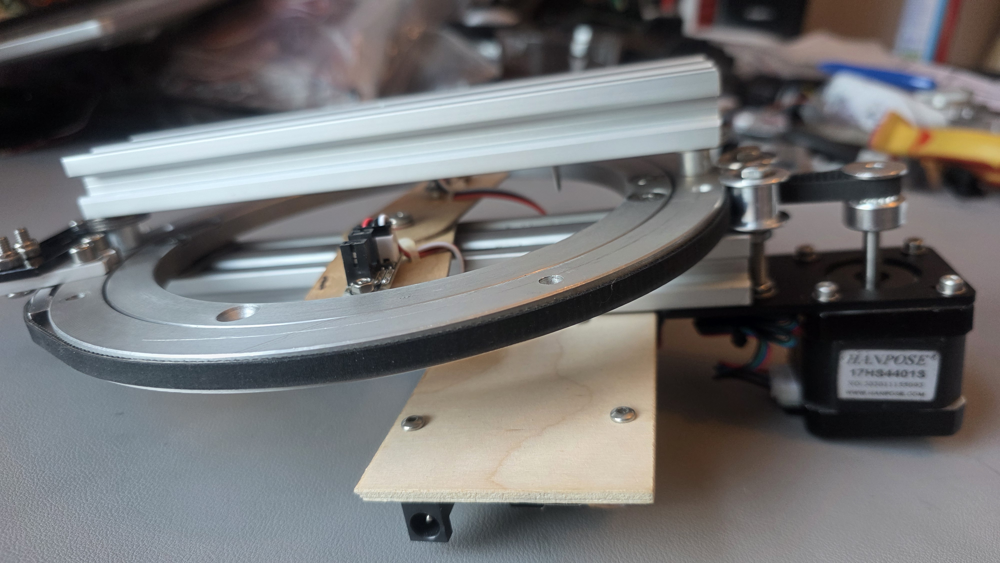
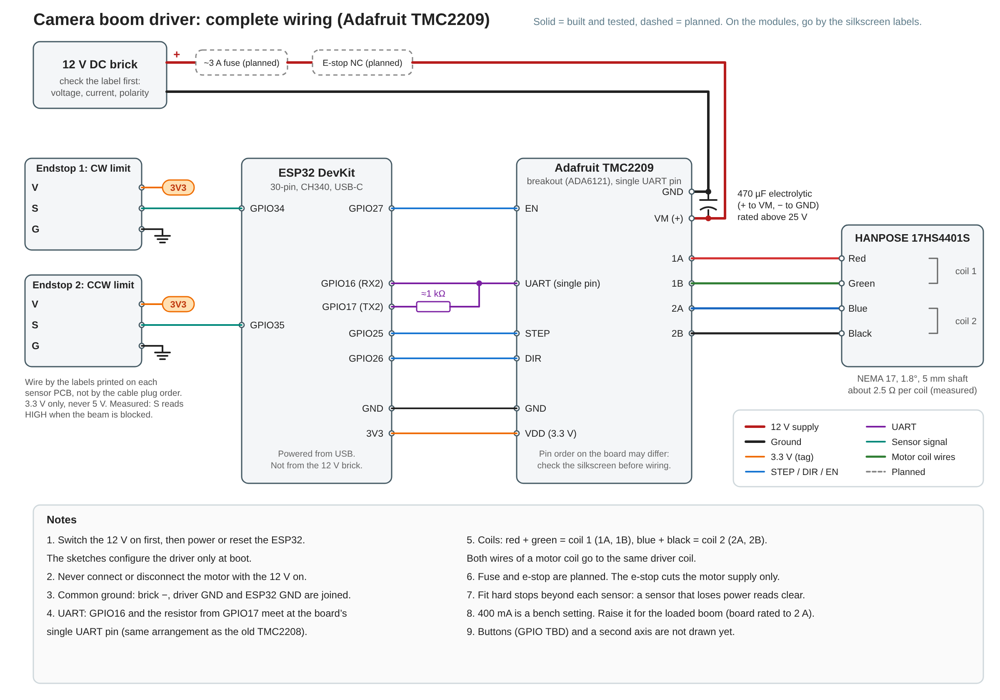

# camera_boom_driver

A motorised, ceiling-mounted camera boom.

ESP32 firmware to motorise a ceiling-mounted camera boom. The boom swings horizontally around a vertical pole through up to 180 degrees, driven by a stepper motor and GT2 belt on a 200 mm lazy-susan bearing. Control is by a web UI served by the ESP32 over its own WiFi network. A second (tilt) axis may be added later.

Design decisions, safety requirements and working rules live in [AGENTS.md](AGENTS.md). Wiring and bring-up are in [docs/wiring.md](docs/wiring.md). Serial monitor commands for each sketch are in [docs/serial_commands.md](docs/serial_commands.md). Speed, acceleration and current settings are in [docs/speed_and_current.md](docs/speed_and_current.md). What is still to do is in [docs/outstanding.md](docs/outstanding.md).

## The built controller

Photos taken 2026-11-20. The arm is not fitted yet.



*Top view: the NEMA 17 (left), the ESP32 on its breakout shield and the Adafruit driver on the ply, the 2040 across the inner ring, and the belt anchor with its tensioner screw (right).*



*Angled view from the motor end: the ESP32 shield, the Adafruit TMC2209 with its green motor terminal block, and the 470 uF capacitor, all on the ply on top of the 2040.*



*Side view: the electronics on top of the 2040, an optical sensor on a ply strip under it, the belt on the ring's rim and the anchor screw at the left.*



*The drive: 20-tooth motor pulley, two idlers and the belt on the outer ring, with the two optical sensors on ply strips inside the ring.*



*The motor side (HANPOSE 17HS4401S label), with the pulley and belt and a sensor strip inside the ring, resting on the bench.*

Layout (from you, 2026-11-20, unless marked otherwise):

- **Mounting:** the motor, the optical sensors and the ESP32 are mounted on the top surface of the inner ring. The whole controller will be mounted from the top-side 2040, right next to the ply that holds the ESP32.
- **Arm:** not connected yet. It will attach to the length of 2040 on the underside of the bearing.
- **Drive:** a 20-tooth GT2 pulley on a 200 mm ring. A 20-tooth, 2 mm pitch pulley has a pitch diameter of about 12.7 mm, so the ratio is about 16:1 (200 / 12.7 is about 15.7). That is calculated, not measured, and still needs calibrating.
- **Belt travel:** the open belt sets a real mechanical limit of about 320 degrees. The working sweep is much smaller (120 degrees in the design, 180 in sketch 09), so this is not a substitute for hard stops inside the working range.
- **Bearing:** the moment load from the arm has been tested and is fine (how it was tested is not recorded).
- **Power:** the capacitor is 470 uF, 35 V. The ESP32 shield has its own DC jack (6.5 to 16 V input); the plan is to power the ESP32 from a separate adapter or block supply. The e-stop on the motor supply will then leave the ESP32 running, and the two supplies need a common ground.

## Hardware components


*The 200 mm aluminium lazy-susan bearing the boom turns on. The inner ring is fixed to the hanging structure; the outer ring rotates with the boom and carries the belt.*

| Part | Details | Status |
|---|---|---|
| Bearing | 200 mm (8 inch) aluminium lazy-susan ball bearing, small amount of drag | Owned. Moment load from the arm tested, fine (user) |
| Frame | 2020/2040 aluminium extrusion hanging structure; the boom is balanced, about 50 cm from the pole axis. The controller is built on the top 2040; the arm will attach to the 2040 on the underside of the bearing | Controller built (photos above). Arm not fitted yet |
| Belt drive | 6 mm GT2 open belt around the outer ring, ends anchored on the far side, screw tensioner (no springs, so the drive is not elastic); 20-tooth GT2 motor pulley and two smooth idlers on a fixed plate | Built. 20-tooth pulley and 200 mm ring confirmed (user). Belt limits travel to about 320 degrees (user). Ratio about 16:1 and about 17,000 microsteps per 120 degrees at 16 microsteps are calculated, not measured, until calibrated |
| Motor | HANPOSE 17HS4401S, NEMA 17, 40 mm, 1.8 degree, 5 mm D shaft. Listings disagree on current (1.5 to 1.7 A) and resistance; about 2.5 ohm per coil measured | Tested, runs smoothly and quietly |
| Driver | Adafruit TMC2209 breakout (ADA6121): 5 to 29 V, up to 2 A set by the pot, single UART pin; run at about 740 mA for bench tests (800 mA in sketch 09). It replaced the BIGTREETECH TMC2208 V3.0 (details in [docs/wiring.md](docs/wiring.md)) | Motor runs on it (user-confirmed). Sense resistors 0.05 ohm (Adafruit schematic) |
| Controller | ESP32 30-pin dev board (CH340, ESP32-D0WD-V3), 3.3 V logic. Classic ESP32 only | Tested |
| Limit sensors | Two BIQU optical endstop boards (TCST2103), 3.3 V, active-HIGH, on GPIO 34 (CW) and GPIO 35 (CCW) | Tested |
| Power | 12 V supply and a 470 uF, 35 V capacitor across the driver supply. The ESP32 shield has its own DC jack and is planned to run from a separate adapter supply. Planned: about 3 A fuse and a normally closed e-stop that cuts the motor supply only | Supply label (voltage, current, polarity) not confirmed. Fuse and e-stop not wired. Separate ESP32 supply not yet fitted |
| Hard stops | Mechanical stops on the fixed structure beyond each sensor | Planned. Distance to be decided |
| Controls | Two physical buttons (go to 0, go to 120) and a tablet web UI | Buttons not written. Web UI started in sketch 07, calibration and HOME/RESET in sketch 08 |

Figures marked as estimates, and anything not confirmed, still need checking on the real hardware. The sense resistor on the Adafruit TMC2209 board is 0.05 ohm (Adafruit's schematic; the board marking "50" agrees). All sketches 04 to 09 now use 0.05 (04 to 08 were changed from 0.11 on 2026-11-20 and their current raised from 400 to 740 mA, which is the real current sketch 08 passed at on this board).

## Wiring diagram



The diagram shows the Adafruit TMC2209 driver. Solid lines are built; the fuse and e-stop are drawn dashed because they are planned. The 12 V brick's label, the Adafruit board's pin order and the TX resistor value are not confirmed, so go by the silkscreen on each module.

## Sketches

Built up in small steps, so each hardware or software unknown is proven on its own. Arduino needs one sketch per folder.

| Sketch | Purpose | State |
|---|---|---|
| `01_blink_button` | Toolchain, upload, serial, input reading | Tested on hardware: passed |
| `02_opto_endstop` | Optical limit sensor (active-HIGH as wired) | Tested on hardware: passed (active-HIGH) |
| `03_wifi_ap_test` | Joins home WiFi (DHCP), serves test page; falls back to own access point | Station mode tested on hardware (joins home WiFi, DHCP). AP fallback untested |
| `04_tmc2208_uart_test` | TMC2208 UART read/write check, no motion | Tested on hardware: PASS |
| `05_first_motor_move` | First motor motion: unloaded, 740 mA, slow, serial-commanded finite moves, idle auto-disable | Tested on hardware: turns smoothly, no driver faults (3200 steps/rev assumed) |
| `06_limit_shuttle` | Unloaded, 740 mA. Auto-starts after a 5 s countdown: seeks the CW sensor, measures travel to the CCW sensor, then shuttles between them forever, logging the position error at each hit | Tested on hardware: passed. Sensors measured active-HIGH on the bench (conflicts with the active-LOW note for sketch 02) |
| `07_web_shuttle` | Sketch 06's ping-pong shuttle driven from a web page: joins home WiFi (DHCP, AP fallback), START/STOP button and a live speed slider. Waits for START (no auto-start); STOP decelerates and holds, START resumes | Tested on the boom: all features passed (START/STOP, resume, live speed slider). AP fallback path not confirmed. Needs its own `secrets.h` |
| `08_web_boundaries` | Self-calibrating web shuttle: after boot it seeks both optical sensors to learn the working area (sensors can be moved between sessions), goes home at the end chosen by `HOME_AT_CW_END` in `config.h`, then the page offers START/STOP (a run sweeps between the ends), a live speed slider, RESET (seek the boundaries again) and HOME. Starts moving by itself after a 5 s countdown (`AUTO_CALIBRATE_ON_BOOT`) | Tested on the boom with the Adafruit TMC2209: homed and responded correctly to all commands. AP fallback path not confirmed. Needs its own `secrets.h` |
| `09_boom_v1` | First production version, built from sketch 08. Seek speed 2000 Hz. Run speed range set as the time for a 180 degree move (fastest 2.5 s, slowest 6 s, default slowest), acceleration proportional to speed (`RAMP_TIME_S`). START sends the boom one leg in the current direction to the far boundary and stops there with the motor holding, then flips the direction flag; the next START goes back. STOP decelerates and holds, and START then resumes to the same end. HOME and RESET as in 08. STOP & DISABLE MOTOR button: decelerates on the ramp, then switches the driver off so the boom can be moved by hand; afterwards the page accepts only RESET (it forgets the boundaries and seeks both sensors again) | UNTESTED on hardware, only syntax-checked. The speeds are far above anything tested before; the current is set to 800 mA for the unloaded boom (untested). Needs its own `secrets.h` |

The driver was switched to the Adafruit TMC2209 on 2026-11-19 and the motor runs. Sketches 04 to 09 still use the `TMC2208Stepper` class. All of them use 0.05 ohm, the real sense resistor value of the new board (04 to 08 changed from 0.11 on 2026-11-20). Sketches 01 to 08 have passed on hardware (08 on the Adafruit TMC2209). Only the access point fallback path in 03, 07 and 08 (used when the home network cannot be joined) is not confirmed.

Not yet written: absolute moves in degrees (go to angle, eased sweep over a set duration), the two physical buttons, the rest of the web UI (go to angle, presets, jog) and a hardware e-stop with firmware support. Sketches 06 and 07 already home to the CW limit and shuttle between the sensors.

## Setup

- Arduino IDE 2.x with the **esp32 by Espressif Systems** board package. Pin the core version once a combination works; libraries lag behind new cores.
- Board: **ESP32 Dev Module** (classic ESP32, not S3 or C3).
- **Upload speed: 115200.** Uploads failed at 921600 on this CH340 board.
- Libraries (Library Manager): **TMCStepper** now; **FastAccelStepper** when motion is added.
- If the upload hangs on "Connecting...", hold the BOOT button until it starts.

## WiFi credentials

Your network name and passwords are not committed. Before building sketch 03 (and likewise 07, 08 and 09):

```
cd sketches/03_wifi_ap_test
cp secrets.example.h secrets.h     # then edit secrets.h
```

`secrets.h` holds `WIFI_SSID`, `WIFI_PASSWORD` and `AP_PASSWORD` (for the fallback access point) and is gitignored. The ESP32 only joins 2.4 GHz networks. The serial monitor prints the DHCP address it received; `http://boom.local` also works where mDNS is supported.

## Safety

The boom swings at head height. A hardware e-stop that cuts the motor supply must work independently of the firmware and WiFi. Never connect or disconnect the motor while the driver is powered. Treat all ratio, torque and current figures as estimates until calibrated on the real arm.
