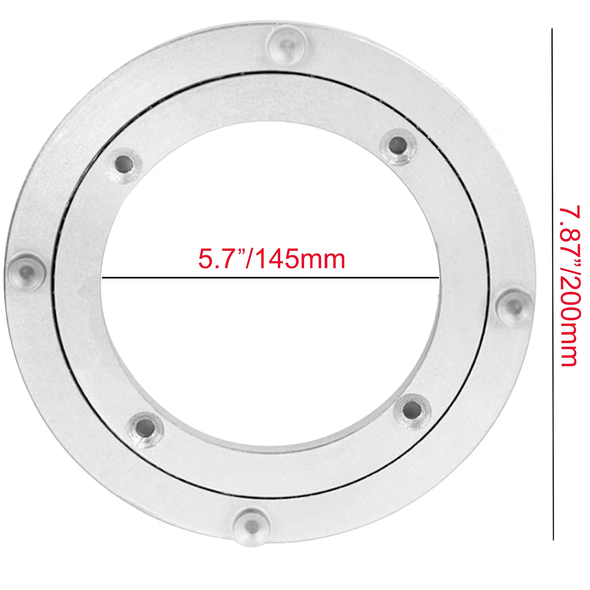

# camera_boom_driver

ESP32 firmware to motorise a ceiling-mounted camera boom. The boom swings horizontally around a vertical pole through up to 120 degrees, driven by a stepper motor and a GT2 belt on a 200 mm lazy-susan bearing. Control is by two physical buttons (go to 0, go to 120) and, later, a tablet web UI served by the ESP32 over its own WiFi network. A second (tilt) axis may be added later.

Design decisions, safety requirements and working rules live in [AGENTS.md](AGENTS.md). Wiring and bring-up are in [docs/wiring.md](docs/wiring.md).

## Hardware components



*The 200 mm aluminium lazy-susan bearing the boom turns on. The inner ring is fixed to the hanging structure; the outer ring rotates with the boom and carries the belt.*

| Part | Details | Status |
|---|---|---|
| Bearing | 200 mm (8 inch) aluminium lazy-susan ball bearing, small amount of drag | Owned |
| Frame | 2020/2040 aluminium extrusion hanging structure; the boom is balanced, about 50 cm from the pole axis | Design |
| Belt drive | 6 mm GT2 open belt around the outer ring, ends anchored on the far side, screw tensioner (no springs, so the drive is not elastic); 20-tooth GT2 motor pulley and two smooth idlers on a fixed plate | Design. Ratio about 16:1 and about 17,000 microsteps per 120 degrees at 16 microsteps are estimates until calibrated |
| Motor | HANPOSE 17HS4401S, NEMA 17, 40 mm, 1.8 degree, 5 mm D shaft. Listings disagree on current (1.5 to 1.7 A) and resistance; about 2.5 ohm per coil measured | Tested, runs smoothly and quietly |
| Driver | BIGTREETECH TMC2208 V3.0 (UART variant), run at 400 mA for bench tests. Planned: Adafruit TMC2209 breakout (ADA6121), see [docs/wiring.md](docs/wiring.md) | TMC2208 tested. TMC2209 planned, untested |
| Controller | ESP32 30-pin dev board (CH340, ESP32-D0WD-V3), 3.3 V logic. Classic ESP32 only | Tested |
| Limit sensors | Two BIQU optical endstop boards (TCST2103), 3.3 V, active-HIGH, on GPIO 34 (CW) and GPIO 35 (CCW) | Tested |
| Power | 12 V supply and a 470 uF capacitor across the driver supply. Planned: about 3 A fuse and a normally closed e-stop that cuts the motor supply only | Supply label (voltage, current, polarity) not confirmed. Fuse and e-stop not wired |
| Hard stops | Mechanical stops on the fixed structure beyond each sensor | Planned. Distance to be decided |
| Controls | Two physical buttons (go to 0, go to 120) and a tablet web UI | Buttons not written. Web UI started in sketch 07 |

Figures marked as estimates, and anything not confirmed, still need checking on the real hardware. The sense resistor on the TMC2208 module (assumed 0.11 ohm) is also unconfirmed.

## Wiring diagram


Solid lines are built and tested; the fuse and e-stop are drawn dashed because they are planned. The 12 V brick's label, the driver's pin order and the TX resistor value are not confirmed, so go by the silkscreen on each module.

## Sketches

Built up in small steps, so each hardware or software unknown is proven on its own. Arduino needs one sketch per folder.

| Sketch | Purpose | State |
|---|---|---|
| `01_blink_button` | Toolchain, upload, serial, input reading | Earlier version tested on hardware |
| `02_opto_endstop` | Optical limit sensor (active-HIGH as wired) | Earlier version tested; polarity constant since corrected, not re-run |
| `03_wifi_ap_test` | Joins home WiFi (DHCP), serves test page; falls back to own access point | Station mode tested on hardware (joins home WiFi, DHCP). AP fallback untested |
| `04_tmc2208_uart_test` | TMC2208 UART read/write check, no motion | Tested on hardware: PASS |
| `05_first_motor_move` | First motor motion: unloaded, 400 mA, slow, serial-commanded finite moves, idle auto-disable | Tested on hardware: turns smoothly, no driver faults (3200 steps/rev assumed) |
| `06_limit_shuttle` | Unloaded, 400 mA. Auto-starts after a 5 s countdown: seeks the CW sensor, measures travel to the CCW sensor, then shuttles between them forever, logging the position error at each hit | UNTESTED on hardware (compiles for ESP32 Dev Module). Sensors measured active-HIGH on the bench (conflicts with the active-LOW note for sketch 02). Clockwise DIR level unverified |

| `07_web_shuttle` | Sketch 06's ping-pong shuttle driven from a web page: joins home WiFi (DHCP, AP fallback), START/STOP button and a live speed slider. Waits for START (no auto-start); STOP decelerates and holds, START resumes | UNTESTED on hardware (compiles for ESP32 Dev Module). Needs its own `secrets.h` |

"Earlier version tested" means the original single-file sketch ran on the real board. Sketches 01 to 03 have since been split into a `config.h` per sketch and have not been recompiled, so report anything that fails to build.

Not yet written: homing in the final form, absolute moves in degrees, buttons, the web UI. Sketch 06 contains a first seek-to-limit, but it is untested.

## Setup

- Arduino IDE 2.x with the **esp32 by Espressif Systems** board package. Pin the core version once a combination works; libraries lag behind new cores.
- Board: **ESP32 Dev Module** (classic ESP32, not S3 or C3).
- **Upload speed: 115200.** Uploads failed at 921600 on this CH340 board.
- Libraries (Library Manager): **TMCStepper** now; **FastAccelStepper** when motion is added.
- If the upload hangs on "Connecting...", hold the BOOT button until it starts.

## WiFi credentials

Your network name and passwords are not committed. Before building sketch 03 (and likewise 07):

```
cd sketches/03_wifi_ap_test
cp secrets.example.h secrets.h     # then edit secrets.h
```

`secrets.h` holds `WIFI_SSID`, `WIFI_PASSWORD` and `AP_PASSWORD` (for the fallback access point) and is gitignored. The ESP32 only joins 2.4 GHz networks. The serial monitor prints the DHCP address it received; `http://boom.local` also works where mDNS is supported.

## Safety

The boom swings at head height. A hardware e-stop that cuts the motor supply must work independently of the firmware and WiFi. Never connect or disconnect the motor while the driver is powered. Treat all ratio, torque and current figures as estimates until calibrated on the real arm.
