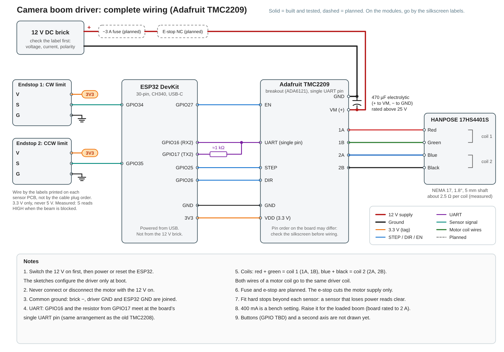

# Wiring

Wiring notes. Sections are marked TESTED where the arrangement has been run on the real hardware, and otherwise are plans. Go by the silkscreen on your own boards. The driver is now an Adafruit TMC2209 breakout, which replaced the BTT TMC2208 V3.0 on 2026-11-19; the TMC2208 notes are kept below for reference. Calculated figures (ratio, steps per degree, current) are estimates.

## Wiring diagram



The diagram shows the Adafruit TMC2209 wiring. Solid lines are built; the fuse and e-stop are planned and drawn dashed. Buttons and a second axis are not drawn. The 12 V brick's label, the Adafruit board's pin order and the TX resistor value are unconfirmed, so go by the silkscreen on each module. The tables below are the detail behind this diagram.

## ESP32 pin plan

STEP, DIR, EN and the UART pins below were TESTED with sketches 04 and 05 on the TMC2208, and the motor runs on the same pins with the Adafruit TMC2209 (user-confirmed; the pins are assumed unchanged). The second limit sensor and the buttons are still plans.

| Function | GPIO | Notes |
|---|---|---|
| STEP | 25 | to driver STEP |
| DIR | 26 | to driver DIR |
| EN | 27 | active LOW: HIGH disables the motor |
| Driver UART RX | 16 | direct to the driver's UART pin |
| Driver UART TX | 17 | through 1k to the same UART pin |
| Limit sensor A | 34 | input-only, no internal pull-up |
| Limit sensor B | 35 | input-only, no internal pull-up |
| Buttons | TBD | |
| Onboard LED | 2 | strapping pin, LED only |

Avoid GPIO 0, 2, 12, 15 (boot strapping) for motor signals, GPIO 6-11 (flash), and ADC2 pins while WiFi is on. GPIO 34-39 are input-only.

## Previous driver: TMC2208 (BIGTREETECH V3.0, UART variant), replaced

Replaced by the Adafruit TMC2209 (see the section below) on 2026-11-19. Kept as a record of what was tested with it.

| Driver pin | Connect to |
|---|---|
| VM | 12 V positive, via about 3 A fuse (and e-stop later) |
| GND (motor side) | Supply negative |
| 470 uF, 35 V capacitor | Across VM and GND at the driver (long lead positive). This table originally said 100 uF; 470 uF is what is fitted (user-confirmed 2026-11-20) |
| VIO | ESP32 3V3 |
| GND (logic side) | ESP32 GND, common with supply negative |
| EN / STEP / DIR | GPIO 27 / 25 / 26 |
| PDN_UART | GPIO 16 direct, and GPIO 17 via 1k |
| OA1 OA2 OB1 OB2 | Motor coils, see the Motor section below (leave disconnected for the first UART test) |
| MS1, MS2 | Unconnected |

- The V3.0 ships as STEP/DIR or UART. This unit has J2 bridged by a surface-mount link, so it is the UART variant. Do not alter J2.
- `R_SENSE`: assumed 0.11 ohm for the TMC2208 sketches. For the Adafruit TMC2209 Adafruit's schematic gives 0.05 ohm (R1 and R2; see the Adafruit section below); sketches 04 to 09 now use 0.05 (04 to 08 used 0.11 until 2026-11-20).
- The TMC2208 needs VM present before it answers on UART.
- **PDN_UART is the 4th header pin counting EN as 1** (EN, MS1, MS2, PDN_UART). Confirmed working on this unit. The GPIO 16 wire and the resistor from GPIO 17 must both land on that same pin. The 5th pin is also silkscreened PDN-UART but is NOT continuous with the 4th: leave it unconnected, and go by position, not by the label. Putting RX and TX on different pins gives zero bytes back.
- TESTED. UART test (sketch 04) PASSED: chip version 0x20 (TMC2208), writes counted by IFCNT, read-back OK. The current read-back comes from the same R_SENSE the library used to write it, so it does not verify R_SENSE.
- TESTED. First motor move (sketch 05) works: the driver holds 16 microsteps and 397 mA with no over-temperature, short or open-load flags, and the motor runs smoothly up to 2800 Hz unloaded.
- The TMC2208 has no UART addressing. A second axis needs its own UART or a TMC2209.

## Motor (HANPOSE 17HS4401S, NEMA 17, 4-wire harness)

Seller listings disagree on the ratings: about 1.5 to 1.7 A per phase, 1.5 to 1.8 ohm, 2.8 to 3.8 mH, 40 to 43 N.cm holding torque. Torque scales roughly with current, so the bench tests (about 740 mA real on the Adafruit board, 400 mA on the old TMC2208) give only about half (a quarter on the TMC2208) of the holding torque. For the loaded build use a higher current (roughly 800 to 1000 mA RMS to start, below the TMC2208's 1.2 A RMS rating; the Adafruit TMC2209 is rated up to 2 A, but stay near the motor's own rating), fit the heatsink, and watch driver and motor temperatures.

The old TMC2208's motor pins were labelled **OA1, OA2, OB1, OB2** (not 1A/1B/2A/2B). OA1 and OA2 are the two ends of one driver coil, and OB1 and OB2 are the two ends of the other. Both wires of one MOTOR coil must go to the SAME driver coil.

Measured through the harness: each coil is about 2.5 ohm (more than the listed 1.5 to 1.8 ohm, probably meter lead and cable resistance). Colours do NOT follow the common convention on this harness: red/green is one coil and blue/black the other, so always measure.

TESTED wiring on the TMC2208 (see the Adafruit TMC2209 section for the current wiring):

| Motor wire | Motor coil | Driver pin |
|---|---|---|
| Red | coil 1 | OA1 |
| Green | coil 1 | OA2 |
| Blue | coil 2 | OB1 |
| Black | coil 2 | OB2 |

Result: smooth rotation at 397 mA and 16 microsteps, no driver faults. 3200 steps per revolution is assumed (200 full steps x 16) and one turn per 3200 steps has not been explicitly measured. Wiring red/green/blue/black to OA1/OB1/OA2/OB2 (crossing the coils) gives a stuttering half-turn. Swapping the two wires within a coil only reverses direction. Never connect or disconnect the motor with the supply on.

## Driver: Adafruit TMC2209 (ADA6121), in use

The Adafruit TMC2209 breakout replaced the BTT TMC2208 on 2026-11-19 and the motor runs (user-confirmed). It is a complete driver board, not a carrier for the TMC2208.

Motor wiring, as built (both wires of one motor coil stay on the same pair):

| Motor wire | Motor coil | Driver pin |
|---|---|---|
| Red | coil 1 | 1A |
| Green | coil 1 | 1B |
| Blue | coil 2 | 2A |
| Black | coil 2 | 2B |

Logic and power wiring:

| Driver signal | Connect to |
|---|---|
| UART (single pin) | GPIO 16 direct and GPIO 17 through the 1k resistor, joined at the board's single UART pin (the same arrangement as the TMC2208; the resistor was not re-confirmed) |
| STEP / DIR / EN | GPIO 25 / 26 / 27 (assumed unchanged) |
| VDD | ESP32 3V3, not 5V (per Adafruit's guide; not re-confirmed) |
| VM (motor +) and GND | 12 V supply via the planned fuse and e-stop; GND common with the ESP32 |

From Adafruit's guide: 5 to 29 V motor supply, up to 2 A set by the pot (UART can override it), VDD 3 to 5 V, single-pin UART with auto-baud, SPRD jumper open = StealthChop, no heatsink included. The board has its own 22 uF capacitor; the 470 uF, 35 V capacitor is fitted across VM and GND (user-confirmed, visible in the photos). The optional DIAG output is not wired.

- First attempt: the motor ticked and rocked without turning, and it now works. The cause of the fix was not recorded. The usual cause is a coil wired to the wrong pair: keep red + green on 1A/1B and blue + black on 2A/2B.
- Sketches 04 to 08 still use the `TMC2208Stepper` class. They drive the TMC2209 (user-confirmed). `R_SENSE` was 0.11 ohm, which is wrong for this board: Adafruit's Eagle schematic (checked 2026-11-20) has R1 and R2 at 0.05 ohm on BRA and BRB, and the board marking "50" agrees. On 2026-11-20 they were changed to 0.05 and `MOTOR_RMS_CURRENT_MA` raised from 400 to 740 mA, which gives the same real current (about 740 mA) that sketch 08 ran at on this board.
- Confirmed with sketch 08 (`08_web_boundaries`) on the TMC2209: it reports `chip version 0x21`, homed and responded correctly to all commands.
- ESP32 power: the ESP32 shield has its own DC jack and is planned to run from a separate adapter or block supply (user, 2026-11-20; not yet fitted). The shield's DC input is rated 6.5 to 16 V and the jack is centre positive (user-confirmed); the plug outer diameter is 5.5 mm (user-confirmed), centre-pin size (2.1 or 2.5 mm) not yet measured. Do not use a laptop supply (most are 18 to 20 V). The e-stop on the motor supply will then not cut the ESP32, and the ESP32 and motor supplies need a common ground (the driver's logic GND to the ESP32 GND already provides one if both ground wires are fitted; check this when it is wired).
- Not recorded: the pot setting, the MS1/MS2 state and how MS1/MS2 set the UART address. A second axis on the same UART needs those checked.

## Power

- Motor supply: 12 V brick. Voltage, current and polarity are **not yet confirmed from its label**. Check before wiring.
- **Power order: switch the 12 V on BEFORE the ESP32 starts (or press the ESP32 EN/reset button after the 12 V is on).** The sketches configure the driver only at boot. One bench run showed the driver on its defaults (8 microsteps, about 718 mA) with the setup lines reporting no reply, which fits the ESP32 having booted with the 12 V off.
- Keep the ESP32 on USB during bench tests. Do not also feed the 12 V into the ESP32 board's DC jack. The two supplies share only ground.
- Final build: fuse, then e-stop (cutting the motor supply only, so the ESP32 stays alive), then the capacitor and driver.
- Never connect or disconnect the motor with the supply on.

## Optical endstop (BIQU, TCST2103)

| Sensor pin (use PCB labels) | Connect to |
|---|---|
| V | ESP32 3V3 (not 5V) |
| G | ESP32 GND |
| S | GPIO 34 |

TESTED as currently wired at 3.3 V: ACTIVE-HIGH (signal reads LOW with the beam clear and HIGH when the beam is blocked, sensor LED lit when blocked). An earlier note here said active-LOW; that was an inference from sketch 02's LED behaviour and is superseded by the measurement with sketch 06's `?` command. One reviewer reported the supplied cable plug order not matching the board's pin labels, so wire by the PCB labels.

### Second sensor and the shuttle sketch (tested)

Sketch `06_limit_shuttle` uses two sensors, one at each end of the travel. Wire the second sensor the same way as the first, by the PCB labels:

| Sensor | V | G | S |
|---|---|---|---|
| CW limit (the end reached by turning clockwise, viewed from above) | 3V3 | GND | GPIO 34 |
| CCW limit | 3V3 | GND | GPIO 35 |

Wiring diagram (3V3 and GND each feed both sensors; each S goes to its own GPIO):

```
 ESP32 30-pin board                 SENSOR 1 (CW limit)
 +---------------+
 | 3V3 ----------+--+-------------> V
 |               |  |               G <---------+
 | GPIO 34 <-----+--|---------------S           |
 |               |  |                           |
 |               |  |               SENSOR 2 (CCW limit)
 |               |  +-------------> V
 | GPIO 35 <-----+------------------S
 |               |                  G <---------+
 | GND ----------+------------------------------+
 +---------------+
```

Wiring notes:

- Wire by the labels printed on each sensor's PCB (V, G, S), not by the cable plug order, which one reviewer found did not match the board.
- Power both sensors from 3V3, never 5V: a 5V signal on a GPIO can damage the ESP32. Each sensor draws about 20 mA.
- GPIO 34 and 35 are input-only with no internal pull-up, so each sensor board's own pull-up does the work. An unplugged sensor leaves the pin floating, so it can read anything.
- Keep the sensor leads short and away from the motor wires. If you see false triggers, add 100 nF across S and G at the sensor.
- Mount a hard mechanical stop beyond each sensor, and make each flag long enough that the boom can finish decelerating while the sensor is still blocked. An optical sensor that loses power or a wire that falls off reads "clear", so the firmware cannot rely on the sensors alone.

- MEASURED on the bench with sketch 06's `?` command: with the beams clear both pins read LOW, and a blocked beam makes that sensor's pin read HIGH (active-HIGH, sensor LED lit when blocked). So `CW_BLOCKED_IS_HIGH` and `CCW_BLOCKED_IS_HIGH` in `sketches/06_limit_shuttle/config.h` are both `true`. The user has confirmed this measurement is correct. Re-check with `?` (raw pin levels, beam clear and blocked) if a sensor is swapped or rewired.
- Tested: the direction is correct on the boom as built. Which DIR level turns the boom clockwise depends on how the motor is mounted: `CW_IS_DIR_HIGH` in the same file. If the motor is ever remounted or rewired and the boom goes the wrong way it reaches the other sensor first and the sketch stops with "wrong limit: check direction or sensor wiring"; flip the constant and reset.
- The sketch auto-starts 5 s after boot (send `s` to abort). It is unloaded-motor only at 740 mA. Keep a hand on the e-stop and a physical stop in place: an optical sensor that loses power or a wire that falls off reads "clear".
- Both sensors blocked at once, or either sensor on a cable fault that makes it read blocked, ends in a fault and a disabled motor.

## Bring-up order

Steps 1 to 7 were run with the BTT TMC2208. The driver was then swapped for the Adafruit TMC2209 (see above) and sketch 08 passed on it; whether sketches 04 to 07 were re-run on it was not recorded.

1. `01_blink_button` - done
2. `02_opto_endstop` - done (sketch config set active-HIGH to match the measured wiring)
3. `03_wifi_ap_test` - done (station mode on the home network; AP fallback untested)
4. `04_tmc2208_uart_test` - done: PASS with motor disconnected, 12 V on VM, EN held HIGH
5. `05_first_motor_move` - done: unloaded motor, 400 mA, smooth
6. `06_limit_shuttle` - PASS: seek CW limit, measure travel, shuttle between both sensors
7. `07_web_shuttle` - PASS on the boom: web page with START/STOP and a live speed slider
8. `08_web_boundaries` - PASS on the boom with the Adafruit TMC2209 (chip version 0x21): seeks both sensors at boot to learn the working area, goes home, web START/STOP, speed slider, RESET, HOME
9. Absolute moves in degrees (next)
10. Buttons, then the rest of the web UI and saved presets
11. Calibrate steps per degree on the real arm
